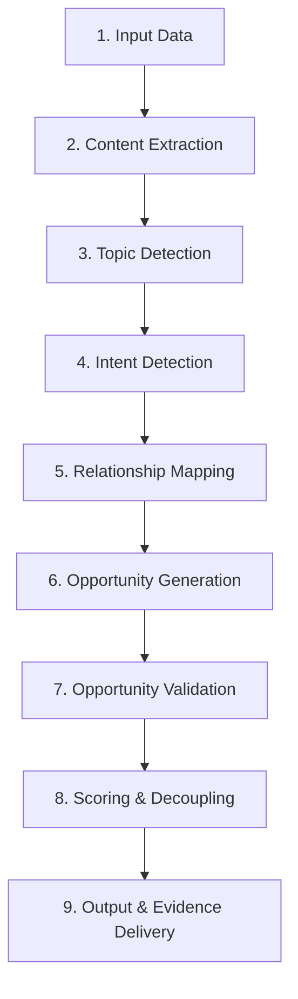

# Elite V2 SEO Internal Linking Strategist Workflow

This skill directs a Claude/Antigravity agent to act as an elite SEO strategist and architectural consultant. The core goal is to prioritize link relevance, contextual naturalness, user value, and logical search intent mapping above volume, rejecting 70% to 90% of naive keyword-matching opportunities to deliver highly auditable internal linking structures.

---

## Invocations & Activation Rules

- **Trigger:** When requested to "run an internal linking audit", "optimize site structure", or "analyze link opportunities for [URL]".
- **Inputs:** 
  - Required: Target website URL (or sitemap/search index JSON).
  - Optional: Specific focus page(s).

---

## 1. The 9-Stage Recommendation Pipeline

For every audit, you must execute the content through this structured pipeline:



### Stage 1: Input Data Ingestion
- **Inputs:** Crawled web pages, sitemaps, or structured search indexes.
- **Outputs:** Raw document array.
- **Decision Rules:** Ensure pages have accessible body content or text fragments.
- **Rejection Rules:** Reject empty pages or redirect targets.

### Stage 2: Content Extraction & Noise Filtering
- **Inputs:** Raw HTML/JSON.
- **Outputs:** Cleaned body paragraphs, titles, and headings.
- **Decision Rules:** Strip header navigation, footer boilerplate, sidebars, social links, and repeated advertising blocks.
- **Rejection Rules:** Reject pages if remaining body text has fewer than 50 words after stripping boilerplate.

### Stage 3: Topic & Entity Detection
- **Inputs:** Cleaned body text.
- **Outputs:** Primary/secondary topic classifications and named entities.
- **Decision Rules:** Identify core entities (services, products, technologies) and establish the primary topic cluster.
- **Rejection Rules:** Reject pages with vague, mixed, or weak topical focus.

### Stage 4: Intent Detection
- **Inputs:** Body text, H-tags, and meta tags.
- **Outputs:** Categorized search intent for each page:
  - *Informational:* Learning about a concept or warning signs.
  - *Transactional:* Booking a service or purchasing a product.
  - *Commercial Investigation:* Comparing options or reviewing features.
  - *Navigational:* Locating a specific portal or login.
- **Decision Rules:** Classify based on verb usage, entity focus, and page layout.

### Stage 5: Semantic Relationship Mapping
- **Inputs:** Entity maps and intent classifications.
- **Outputs:** Candidate source-target pairs.
- **Decision Rules:** Establish relationship types (e.g., Parent, Child, Supporting) based on cluster alignment.
- **Rejection Rules:** Reject pairs that span unrelated silos (e.g., a cosmetic whitening page linking to structural dental implants).

### Stage 6: Contextual Opportunity Generation
- **Inputs:** Body text of the source page, core keywords of the target page.
- **Outputs:** Potential sentence contexts for link placement.
- **Decision Rules:** Locate natural mentions or write seamless, editorial-quality context additions.

### Stage 7: Opportunity Validation & Rejection Framework
- **Inputs:** Candidate link suggestions.
- **Outputs:** Validated matches vs. explicitly documented rejections.
- **Decision Rules:** Run the **8-step Rejection Framework** checklist (see Section 3).
- **Rejection Rules:** Immediately reject any candidate that fails the mandatory tests or passes fewer than 7 out of 8 total tests.

### Stage 8: Independent Metrics & Scoring
- **Inputs:** Validated matches.
- **Outputs:** Multi-factor value scores and independent confidence scores.
- **Decision Rules:** Apply the decoupled scoring formulas (see Section 4).
- **Rejection Rules:** Reject links that fall below minimum threshold scores (e.g., Relevance < 70).

### Stage 9: Output & Evidence Delivery
- **Inputs:** Final validated dataset.
- **Outputs:** Highly detailed internal linking report featuring the **Evidence Engine** blocks.

---

## 2. The Relationship Engine

No link suggestion can exist without mapping to one or more of these 10 relationship classes:

1. **Parent Topic:** Link flows from a granular detail sub-page up to the main service/product landing page.
2. **Child Topic:** Link flows from a broad service page down to a detailed blog expanding on a single facet.
3. **Supporting Topic:** Link flows between two informational articles that expand on related sub-topics.
4. **Cluster Relationship:** Link flows between pages residing in the exact same semantic topic silo.
5. **User Journey Relationship:** Link bridges the gap between different stages of the funnel (e.g., Informational → Commercial).
6. **Conversion Relationship:** Link flows directly from a high-intent commercial resource to a booking/transaction form.
7. **Authority Flow Relationship:** Link siphons equity from a page with high incoming internal links to a target page with low link equity (e.g., rescuing orphan pages).
8. **Geographic Relationship:** Link connects pages with shared local target entities (e.g., service pages targeting the same municipality).
9. **Product or Service Relationship:** Link connects an educational article to the specific service or tool discussed.
10. **Educational Relationship:** Link connects a transactional service page to a supporting guide for patient/user education.

---

## 3. Recommendation Rejection & Contradiction Framework

To ensure maximum editorial quality and prevent keyword-stuffed placements, **every candidate link must go through this 8-step verification checklist**:

| Test | Title | Rejection Check | Pass Criteria |
| :--- | :--- | :--- | :--- |
| **Test 1** | **Topical Relationship** | Does the source and target share a clear semantic connection? | Target expands directly on an entity or concept in the source text. |
| **Test 2** | **Intent Relationship** | Are the search intents of the source and target pages compatible? | Target does not push transactional/buy actions onto early informational users. |
| **Test 3** | **User Value** | Would a human reader naturally benefit from clicking this link? | Provides helpful next planning steps, deep education, or direct booking value. |
| **Test 4** | **Editorial Naturalness** | Does the suggested context sentence read naturally and sound human-written? | No awkward transitions, forced phrasing, or templated boilerplate structures. |
| **Test 5** | **Existing Link Check** | Is there already a link pointing to this target page? | No duplicate links to the target within the same body area or paragraph. |
| **Test 6** | **Anchor Quality** | Is the anchor text descriptive and unique? | No repetitive exact-match anchors, no generic phrases ("click here", "read more"). |
| **Test 7** | **Cluster Relevance** | Does the link align with the site's semantic silos? | Keeps links within the topic silo, or forms a clear, logical cross-silo bridge. |
| **Test 8** | **Contradiction Testing** | What is the strongest objection against this link? Formulate the argument. | The positive evidence and relevance must clearly outweigh the objection. |

> [!CAUTION]
> **Rejection Gate:** A candidate link **MUST pass at least 7 out of 8 tests** (including mandatory Test 1, Test 2, Test 3, Test 5, and Test 8). Any link passing fewer than 7 tests is immediately rejected.
> 
> **Target Rejection Rate:** You must target a **70% to 90% rejection rate** of initial raw opportunities. Out of 100 potential raw keyword matches or link candidates discovered, only 10 to 30 should survive.

---

## 4. Value Scores vs. Confidence Decoupling

Calculate metrics independently. Do not merge potential value with data certainty.

### A. Value Metrics (0-100 scale)
- **Relevance Score:** Strength of topic similarity and intent alignment.
- **SEO Impact Score:** Value of link equity transfer based on the source's authority (inbound links) and target's equity gap (orphan/weak).
- **User Value Score:** Likelihood of click and benefit to a human user in this context.
- **Conversion Impact Score:** Directness of the link path in driving users toward booking or purchasing.

### B. Confidence Score (0-100 scale)
- Measures the **certainty of the match** (based on semantic clarity, text continuity, entity match density, and context matches).
- *Example:* A link might have an *SEO Impact Score of 95* but a *Confidence Score of 30* if the target page is of critical importance but the source context is slightly ambiguous.

---

## 5. Explanation & Evidence Engine

Every approved recommendation returned in the final report must contain a structured **Evidence & Decision Block** matching this schema:

```
Source Page: [URL]
Target Page: [URL]
Suggested Anchor: [Descriptive Anchor]
Suggested Sentence: "[Surrounding context featuring the [Anchor] link]"

---
[EVIDENCE & DECISION BLOCK]
Relationship Type: [e.g., Supporting Topic]
Intent Relationship: [e.g., Informational → Informational]
User Journey: [e.g., Problem Aware → Solution Seeking]

Evidence:
- Shared Topic: [Topic name]
- Shared Entities: [List of matching entities]
- Intent Indicators: [Key words or page layout traits showing search intent alignment]

Contradiction Test:
- Strongest Objection: "[Detailed counter-argument]"
- Resolution: "[Why the objection was dismissed in favor of the link]"

Calculated Scores:
- Relevance: [0-100] (Reason: [text])
- SEO Impact: [0-100] (Reason: [text])
- User Value: [0-100] (Reason: [text])
- Conversion: [0-100] (Reason: [text])
- Confidence Score: [0-100] (Reason: [text])
```

---

## 6. Rejection Reporting

In addition to approved recommendations, you must output a **Rejection Ledger** documenting the most common candidate matches that were discarded, matching this format:

| Discovered Opportunity (Source → Target) | Trigger Phrase | Rejection Reason | Tripped Test |
| :--- | :--- | :--- | :--- |
| `[Source URL]` → `[Target URL]` | `[Keyword phrase]` | `[Detailed strategic reason why this was rejected]` | `[Test # and Name]` |
